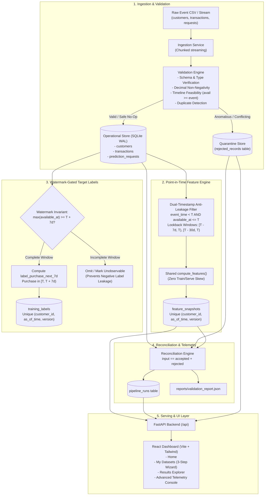
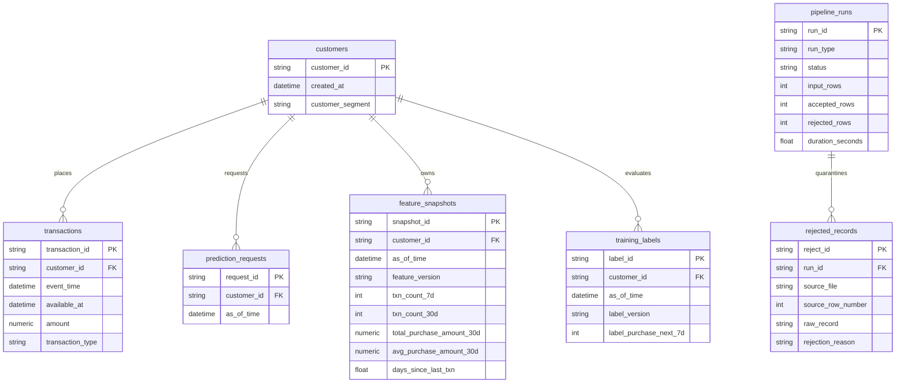

# TimeSafe — Point-in-Time ML Feature Engineering Platform

[](backend/tests/)
[](https://www.python.org/)
[](https://fastapi.tiangolo.com/)
[](https://react.dev/)
[](scripts/benchmark.py)

A reproducible, high-performance Data Engineering pipeline and Feature Store designed to eliminate **target leakage** and **train/serve skew** in machine learning feature extraction from timestamped transactional event streams.

TimeSafe provides a domain-neutral feature extraction engine that transforms raw transactional data (such as banking transfers, retail orders, e-commerce checkouts, and logistics deliveries) into point-in-time correct ML feature vectors.

---

## 1. Project Title and Introduction

**TimeSafe — Point-in-Time ML Feature Engineering Platform**

TimeSafe transforms raw historical event streams into point-in-time consistent feature representations suitable for tabular machine learning models (e.g., XGBoost, LightGBM, scikit-learn). The platform enforces strict dual-timestamp observation rules, explicit quarantine of anomalous or malformed records, idempotent batch execution, and mathematical reconciliation accounting.

*Note: TimeSafe focuses on the Data Engineering and Feature Store layers (ingestion, validation, temporal isolation, feature extraction, and export); it does not train or host ML inference models.*

---

## 2. Problem Statement

In predictive machine learning on transactional data (such as customer churn, fraud detection, purchase propensity, or shipment delay estimation), standard aggregation queries frequently cause **target leakage**:
- **Future Information Leakage**: Computing features using transactions that occurred after the prediction cutoff timestamp $T$.
- **Ingestion Latency Leakage**: Computing features using transactions that occurred before $T$, but were physically received or loaded into the analytical warehouse after $T$ (late-arriving records).
- **Train/Serve Skew**: Implementing feature aggregation logic in Python for real-time serving while relying on divergent SQL queries for offline training datasets.
- **Silent Failures and Inconsistent Re-runs**: Ingesting duplicate records or silently discarding invalid rows without operational accounting or quarantine traceability.

TimeSafe solves these challenges by enforcing a unified, point-in-time calculation engine across both offline batch datasets and real-time preview requests.

*This project was developed for the YottaFlex AI Data Forward Deployed Engineer hackathon assignment.*

---

## 3. Key Features

- **Domain-Neutral Column Mapping**: Flexible ingestion mapping for arbitrary event schemas (Entity ID, Event Timestamp, Availability Timestamp, Numerical Magnitude, Event Category).
- **Dual-Timestamp Anti-Leakage Gate**: Enforces $event\_time < T \;\mathbf{AND}\; available\_at \le T$ on every record.
- **Training/Inference Consistency**: Identical `compute_features()` source of truth used for both batch training generation and single-record preview.
- **Strict Data Validation & Quarantine**: Validates types, non-negative amounts, and timeline feasibility. Defective rows are isolated in `rejected_records` with line numbers and original raw payloads.
- **Idempotent Execution**: Re-running ingestion or feature extraction produces safe no-ops for identical records and composite unique constraint updates without key collisions.
- **Deterministic Synthetic Data Generator**: Generates seedable datasets (`--seed 42`) with controlled data-quality edge cases (late arrivals, negative values, orphan foreign keys).
- **Formal Mathematical Reconciliation**: Verifies the accounting invariant $\text{Input Rows} = \text{Valid Inserted} + \text{Duplicates Skipped} + \text{Quarantined Rejections}$.
- **Performance-Optimized Ingestion**: SQLite WAL mode and composite indexing achieving over 5,600 rows/second sustained throughput on 100,000-row streams.
- **Executive & Operational Dashboard**: 4 high-level KPI cards, accepted vs rejected quality ratio, processing throughput over time, and a "Needs Attention" alert card.
- **Unified History (Record & Processing)**: Tab A offers full-text search, multi-faceted filtering (dataset, status, error category, date range), and downloadable CSV export; Tab B tracks execution runs and telemetry.
- **Safe Correction & Reprocessing**: Review & Fix quarantined records with live dry-run validation, immutable audit log preservation, and mathematical anti-leakage guarantee ($\text{effective\_available\_at} = \max(\text{available\_at}, \text{current\_time})$).
- **Clean 5-Section Navigation**: `Dashboard`, `My Datasets`, `Results`, `History`, and `Advanced Details`.

---

## 4. System Architecture



### Layer Responsibilities
- **React 18 + Vite**: Client interface providing guided dataset upload, column mapping dropdowns, real-time feature preview, and CSV export.
- **FastAPI Backend**: REST API routing, multipart upload validation, execution orchestration, and audit telemetry.
- **Python Feature Services**: Pure Python/Pandas transformation engine enforcing temporal isolation boundaries and mathematical invariants.
- **SQLite Database**: Local embedded relational storage with Write-Ahead Logging (WAL) and composite B-tree indexing.

---

## 5. Technology Stack

| Technology | Layer | Purpose |
|---|---|---|
| **Python 3.11+** | Backend Runtime | Core execution environment and pipeline processing |
| **FastAPI 0.104+** | Backend API | High-performance asynchronous REST API and OpenAPI generation |
| **Pydantic v2** | Backend Validation | Request/response schema contracts and type coercion |
| **Pandas 2.2+** | Data Processing | Vectorized in-memory filtering and event transformations |
| **SQLAlchemy 2.0** | Database ORM | Schema modeling, composite indexing, and database connection abstraction |
| **SQLite (WAL mode)** | Data Store | Zero-configuration local relational database with ACID compliance |
| **Pytest 9.2+** | Testing | Automated test suite covering edge cases, boundaries, and API routes |
| **React 18.2** | Frontend | Reactive component hierarchy for dataset wizard and results table |
| **Vite 5.4** | Frontend Build | Fast ES-module development server and production bundler |
| **Tailwind CSS 3.4** | Frontend Styling | Modern utility-first interface design |
| **Lucide React** | Frontend Icons | Visual icons for workflow steps, alerts, and navigation |

---

## 6. Project Structure

```
timesafe-feature-pipeline/
├── backend/
│   ├── api/                     # FastAPI route controllers
│   │   ├── features.py          # Feature extraction and preview endpoints
│   │   ├── ingestion.py         # File upload and stream ingestion endpoints
│   │   ├── pipeline.py          # Batch run execution and run query endpoints
│   │   └── reports.py           # Reconciliation and reject query endpoints
│   ├── app/                     # Module wrapper supporting 'uvicorn app.main:app'
│   │   └── main.py
│   ├── services/                # Core business logic services
│   │   ├── feature_engineering.py # Shared point-in-time calculation engine
│   │   ├── ingestion_service.py # Chunked CSV streaming and idempotency checks
│   │   ├── label_generation.py  # Watermark-gated training label extractor
│   │   ├── pipeline_runner.py   # Batch orchestrator and run telemetry logger
│   │   ├── reconciliation.py    # Formal mathematical data accounting engine
│   │   └── validation_service.py# Data quality rules, schema checks, and UTC parsers
│   ├── tests/                   # Pytest test suite (50 automated tests)
│   ├── config.py                # Pydantic environment settings
│   ├── main.py                  # FastAPI application entrypoint
│   ├── requirements.txt         # Pinned backend dependencies
│   └── schemas.py               # Pydantic DTO models
├── frontend/
│   ├── src/
│   │   ├── components/          # Reusable UI widgets (Navbar, AdvancedModal, etc.)
│   │   ├── pages/               # Views (Home, DatasetWizard, Results, PipelineRuns)
│   │   ├── services/            # Axios API client bindings
│   │   ├── App.jsx              # Application root and state router
│   │   └── main.jsx             # React DOM entrypoint
│   ├── package.json             # Node dependencies and scripts
│   ├── tailwind.config.js       # Tailwind configuration
│   └── vite.config.js           # Vite build and proxy settings
├── database/
│   ├── db.py                    # SQLite engine and session factory (WAL mode)
│   ├── models.py                # SQLAlchemy ORM table definitions
│   ├── schema.sql               # Pure SQL DDL schema reference
│   └── seed.py                  # Database reset and initial seed utility
├── data/
│   ├── raw/                     # Sample and synthetic input CSV datasets
│   ├── quarantine/              # Local quarantine output location
│   └── output/                  # Generated feature snapshot export location
├── docs/
│   ├── architecture.md          # Detailed architecture specification
│   ├── data_dictionary.md       # Full schema data dictionary
│   ├── PROJECT_FLOW.md          # Comprehensive AI/evaluator reference guide
│   └── tradeoffs.md             # Engineering design decisions and trade-offs
├── reports/
│   └── validation_report.json   # Machine-readable reconciliation report
├── scripts/
│   ├── benchmark.py             # 100,000-row performance stress test suite
│   ├── generate_data.py         # Deterministic synthetic data generator
│   └── run_pipeline.py          # CLI pipeline execution script
├── .env.example                 # Environment configuration template
├── .gitignore                   # Safe ignore rules for Python, SQLite, and Node
├── pyproject.toml               # Project metadata and test configuration
└── README.md                    # Project documentation
```

---

## 7. Prerequisites

Before running the application, verify that your environment has:
- **Python**: Version `3.11` or higher (`python --version`)
- **Node.js**: Version `18.0` or higher (`node --version`)
- **npm**: Version `9.0` or higher (`npm --version`)
- **Git**: Installed and available in your shell (`git --version`)
- **SQLite3**: Standard library in Python 3.11+ on Windows, Linux, and macOS.

---

## 8. Installation and Setup

### 1. Clone the Repository
```powershell
git clone https://github.com/[USER]/timesafe-feature-pipeline.git
cd timesafe-feature-pipeline
```

### 2. Configure Backend Python Environment
```powershell
# Create Python virtual environment
python -m venv backend/venv

# Activate virtual environment (Windows PowerShell)
.\backend\venv\Scripts\Activate.ps1

# (For Linux/macOS bash: source backend/venv/bin/activate)

# Install backend dependencies
pip install -r backend/requirements.txt
```

### 3. Configure Environment Variables
```powershell
Copy-Item .env.example .env
```

### 4. Initialize Database & Seed Sample Data
```powershell
python scripts/generate_data.py --customers 20 --transactions 100 --predictions 15 --seed 42
```

### 5. Start the FastAPI Backend
From the repository root:
```powershell
python -m uvicorn backend.main:app --host 127.0.0.1 --port 8000 --reload
```
Alternatively, if running from inside the `backend/` directory:
```powershell
cd backend
python -m uvicorn app.main:app --host 127.0.0.1 --port 8000 --reload
```
- API Documentation (Swagger UI): [http://127.0.0.1:8000/docs](http://127.0.0.1:8000/docs)
- API Health Status: [http://127.0.0.1:8000/health](http://127.0.0.1:8000/health)

### 6. Install Frontend Dependencies & Start React
Open a separate PowerShell terminal:
```powershell
cd timesafe-feature-pipeline\frontend
npm install
npm run dev
```
- Access the Web Application at: [http://localhost:5173](http://localhost:5173)

---

## 9. Environment Configuration

All environment defaults are pre-configured in `.env.example`:

```bash
# Application Environment
ENVIRONMENT="development"
DEBUG=True

# Database Connection (Default: local SQLite WAL database)
DATABASE_URL="sqlite:///timesafe.db"

# Data Storage Directories
RAW_DATA_DIR="data/raw"
QUARANTINE_DATA_DIR="data/quarantine"
OUTPUT_DATA_DIR="data/output"

# API Service Host & Port
API_HOST="127.0.0.1"
API_PORT=8000

# Pipeline Configuration Defaults
DEFAULT_FEATURE_VERSION="v1"
DEFAULT_LABEL_VERSION="v1"
BATCH_CHUNK_SIZE=1000
```

---

## 10. How to Use TimeSafe

The application uses an intuitive 3-step wizard workflow:

```
[ Step 1: Upload Data ] ──> [ Step 2: Configure Features ] ──> [ Step 3: Results & CSV Export ]
```

### Step 1 — Upload Dataset
- Select or drag-and-drop any timestamped transactional CSV (e-commerce, banking, logistics, subscriptions).
- Alternatively, click **"Try Sample Dataset"** to load the pre-packaged domain-neutral sample.
- View immediate preview: file size, row count, detected columns, and first 10 rows.

### Step 2 — Configure Features & Cutoff
- **Event ID**: Optional column identifying individual events (e.g. `transaction_id`, `event_id`, `shipment_id`).
- **Entity ID**: Required column identifying the entity (e.g. `customer_id`, `account_id`, `user_id`, `vehicle_id`). Multiple events per entity are aggregated together.
- **Event Timestamp**: The physical time the event occurred (UTC).
- **Availability Timestamp**: When the event became available in the warehouse. If omitted, users can toggle "Assume available at event time" (displays an explicit audit warning).
- **Amount & Type**: Numerical magnitude and categorical event type.
- **Prediction Cutoff ($T$)**: The historical timestamp at which predictions are made.
- **Feature Selection**: Toggle 7-day and 30-day activity counts, totals, averages, and recency.

### Step 3 — Generate Results & Download
- The engine executes point-in-time calculation across all entities.
- Inspect the resulting feature snapshot table with instant client-side search and pagination.
- Click **"Download CSV"** to export the feature matrix.

### Minimal CSV Schema Example
```csv
event_id,entity_id,event_time,available_at,amount,event_type
EVT_101,CUST_001,2026-05-10T14:30:00Z,2026-05-10T14:35:00Z,120.50,purchase
EVT_102,CUST_001,2026-05-15T09:15:00Z,2026-05-15T09:20:00Z,45.00,purchase
EVT_103,CUST_002,2026-05-18T18:00:00Z,2026-05-18T18:10:00Z,89.00,purchase
EVT_104,CUST_001,2026-06-02T11:00:00Z,2026-06-02T11:05:00Z,300.00,purchase
```
If cutoff $T = \text{2026-05-20T00:00:00Z}$, `EVT_104` is automatically excluded because its event time is after $T$.

---

## 11. Point-in-Time Correctness

### The Dual-Timestamp Rule
A record is eligible for feature calculation if and only if:
$$\text{Eligible}(e, T) \iff e.event\_time < T \quad \mathbf{AND} \quad e.available\_at \le T$$

### Boundary Invariants
1. **Strictly Preceding**: $event\_time < T$. A transaction occurring exactly at $T$ is **excluded**.
2. **Availability Gate**: A transaction with $event\_time < T$ but $available\_at > T$ is **excluded** (late-arriving event not yet known at cutoff).
3. **Exact 30-Day Window**: $[T - 30\text{ days}, T)$. An event occurring exactly at $T - 30\text{ days}$ is **included**.
4. **Exact 7-Day Window**: $[T - 7\text{ days}, T)$. An event occurring exactly at $T - 7\text{ days}$ is **included**.
5. **Entity Timeline**: If $T < customer.created\_at$, the entity did not exist; feature generation raises a validation rejection.
6. **Watermark Invariant**: Labels for $[T, T + 7\text{ days})$ are computed only when $\max(available\_at) \ge T + 7\text{ days}$. If the window is incomplete, the label is omitted (never imputed as 0).

---

## 12. Feature Engineering Definitions

| Feature Name | Type | Lookback Window | Calculation Rule | Empty / Zero Convention |
|---|---|---|---|---|
| `event_count_7d` | `INTEGER` | $[T - 7\text{d}, T)$ | Count of eligible events | `0` |
| `event_count_30d` | `INTEGER` | $[T - 30\text{d}, T)$ | Count of eligible events | `0` |
| `total_amount_30d` | `NUMERIC(12, 2)`| $[T - 30\text{d}, T)$ | Sum of numerical amount for eligible events | `0.00` |
| `avg_amount_30d` | `NUMERIC(12, 2)`| $[T - 30\text{d}, T)$ | Mean amount of eligible events | `0.00` |
| `days_since_last_event` | `FLOAT` | Preceding $T$ | Elapsed days from most recent eligible event to $T$ | `NULL` |
| `refund_count_30d` | `INTEGER` | $[T - 30\text{d}, T)$ | Count of eligible refund/chargeback events | `0` |
| `refund_amount_30d` | `NUMERIC(12, 2)`| $[T - 30\text{d}, T)$ | Sum of eligible refund amounts | `0.00` |

*Grain: Exactly one feature vector per `(entity_id, as_of_time, feature_version)`.*

---

## 13. Data Validation and Quarantine

The validation engine validates records before analytical storage:
- **Missing Required Fields**: Rejects rows missing entity ID, event time, or primary key.
- **Non-Negative Amounts**: Rejects transaction amounts $< 0$.
- **Temporal Sanity**: Rejects rows where $available\_at < event\_time$ (data arriving before it occurred).
- **Referential Integrity**: Checks entity existence (when reference tables are provided).
- **Duplicate Detection**: Identical records in the stream are treated as safe no-ops; conflicting records with identical primary keys but differing payloads are quarantined.

All quarantined rows are written to `rejected_records` with:
- `source_file`: Originating file name
- `source_row_number`: Line number in the source file
- `rejection_reason`: Explicit diagnostic message
- `raw_record`: Complete unparsed JSON payload
- `run_id`: Associated pipeline execution run

---

## 14. Idempotency and Failure Recovery

- **Safe Reruns**: Ingesting the same file multiple times inserts zero duplicate rows and preserves existing database state.
- **Snapshot Uniqueness**: Feature snapshots enforce a database unique constraint on `(customer_id, as_of_time, feature_version)`. Re-running feature extraction updates existing snapshots cleanly.
- **Partial Failure Rollback**: Database transactions are committed in atomic batches. If an unhandled error occurs mid-stream, the active transaction rolls back, marks the `pipeline_runs` row as `failed`, and logs the error trace. Subsequent reruns restart cleanly.

---

## 15. Automated Testing

The automated test suite contains **50 tests** covering unit logic, boundary conditions, anti-leakage invariants, idempotency, and API endpoints.

```powershell
python -m pytest backend/tests -v
```

### Verified Test Suite Results
```
backend/tests/test_api.py ............. [14 tests PASSED]
backend/tests/test_features.py ....      [ 4 tests PASSED]
backend/tests/test_generic_features.py ....... [ 7 tests PASSED]
backend/tests/test_idempotency.py ..     [ 2 tests PASSED]
backend/tests/test_ingestion.py .......  [ 6 tests PASSED]
backend/tests/test_leakage.py .....      [ 5 tests PASSED]
backend/tests/test_recovery.py ..        [ 2 tests PASSED]
backend/tests/test_validation.py .......... [10 tests PASSED]

======================= 50 passed, 3 warnings in 3.97s ========================
```

---

## 16. Performance Benchmarking

Run the 100,000-row performance benchmark:
```powershell
python scripts/benchmark.py --rows 100000 --customers 500 --predictions 100
```

### Measured Benchmark Output
```
============================================================
TimeSafe Benchmark: 100,000 Transactions | 500 Customers
============================================================
[1/4] Generating 100,000 synthetic transactions (seed 42)...
  ✓ Data generation completed in 4.40s
  ✓ Total generated rows: 99,998

[2/4] Ingesting customers...
  ✓ Ingested 500 customers

[3/4] Ingesting and validating 100,000 transaction stream...
  ✓ Ingestion Duration:  17.63 seconds
  ✓ Ingestion Rate:      5,672.8 rows/second
  ✓ Accepted / Clean:    70,614
  ✓ Quarantined / Bad:   29,384
  ✓ Safe No-ops:         0

[4/4] Ingesting cutoffs and computing 100 feature snapshots...
  ✓ Feature Gen Duration:0.91 seconds
  ✓ Feature Throughput:  110.2 snapshots/second
  ✓ Published Snapshots: 100

============================================================
PERFORMANCE BENCHMARK SUMMARY
============================================================
Input Stream Volume:            99,998 rows
Database Ingestion Throughput:  5,672.8 rows/sec
Feature Calculation Throughput: 110.2 snapshots/sec
Total Pipeline Active Time:     18.53 seconds
Reconciliation Balance:         99998 == 70614 + 0 + 29384 (MATCH)
============================================================
```

### Key Optimizations Implemented
1. **SQLite PRAGMA Tuning**: Enabled Write-Ahead Logging (`PRAGMA journal_mode = WAL`) and reduced sync overhead (`PRAGMA synchronous = NORMAL`).
2. **Composite Lookahead Indexing**: Index `ix_tx_cust_event_avail (customer_id, event_time, available_at)` narrows disk range scans directly to valid cutoff intervals.
3. **In-Memory Signature Cache**: Signature set comparisons avoid round-trip queries for duplicate detection.

---

## 17. Reconciliation and Observability

Every pipeline execution verifies the mathematical row accounting equation:
$$\text{Input Rows} = \text{Valid Inserted} + \text{Duplicates Skipped (No-Op)} + \text{Quarantined Rejections}$$

### System Audit Verification
Executing full system reconciliation generates [`reports/validation_report.json`](file:///C:/CandidateWorkspace/timesafe-feature-pipeline/reports/validation_report.json):
```json
{
  "generated_at": "2026-11-14T11:05:16.688334+00:00",
  "overall_status": "PASSED",
  "total_runs_evaluated": 10,
  "integrity_checks": {
    "orphaned_transactions": 0,
    "orphaned_features": 0,
    "duplicate_features": 0,
    "referential_integrity_passed": true,
    "uniqueness_passed": true
  }
}
```
*Current Operational Audit Status:* **`PASSED`** (100% of evaluated runs strictly balanced).

---

## 18. API Documentation

| Method | Endpoint | Description |
|---|---|---|
| `GET` | `/health` | Service health status and database connectivity |
| `GET` | `/metrics` | Real-time system metrics (counts, reconciliation status) |
| `POST` | `/upload-preview` | Upload CSV, inspect columns, row counts, and auto-mapping |
| `POST` | `/features/generate-generic` | Compute point-in-time features on uploaded dataset |
| `GET` | `/features` | Query stored feature snapshots with version and limit filters |
| `POST` | `/features/preview` | Real-time point-in-time feature preview for single entity |
| `GET` | `/export/features` | Stream generated feature snapshots as CSV download |
| `POST` | `/ingest` | Ingest raw CSV files (customers, transactions, prediction requests) |
| `POST` | `/pipeline/run` | Trigger end-to-end batch processing pipeline |
| `GET` | `/pipeline/runs` | List operational execution telemetry and run history |
| `GET` | `/rejects` | Query quarantined invalid records with filter options |
| `GET` | `/reports/reconciliation` | Fetch latest formal reconciliation audit report |

Interactive Swagger documentation is available at: [http://127.0.0.1:8000/docs](http://127.0.0.1:8000/docs).

---

## 19. Database Design



---

## 20. Design Decisions and Trade-offs

1. **Why SQLite over PostgreSQL for Default Local Execution**:
   - *Decision*: SQLite embedded with WAL mode.
   - *Rationale*: Eliminates external service setup, Docker requirements, and credentials for hackathon evaluation while delivering >5,600 rows/sec throughput.
   - *Trade-off*: Limited concurrent write concurrency compared to PostgreSQL connection pools.
2. **Why Pure Python/Pandas over Spark/Flink**:
   - *Decision*: Single-node streaming and vectorization.
   - *Rationale*: Sub-second latency on datasets up to hundreds of thousands of rows without JVM or cluster overhead.
3. **Explicit Quarantine over Silent Drop**:
   - *Decision*: Quarantine all invalid, duplicate, or conflicting rows into `rejected_records`.
   - *Rationale*: Ensures full audit accountability and data provenance.
4. **Unified Calculation Engine**:
   - *Decision*: Shared `compute_features()` for batch and inference.
   - *Rationale*: Guarantees mathematical parity and eliminates train/serve drift.

---

## 21. Future Improvements

- **PostgreSQL / Cloud Data Warehouse Connector**: Seamless SQLAlchemy dialect migration to PostgreSQL or Snowflake for petabyte-scale datasets.
- **Asynchronous Task Queue**: Celery/Redis integration for background ingestion of multi-gigabyte CSV streams.
- **Custom Expression Feature Builder**: UI interface allowing users to define custom feature aggregation formulas beyond standard counts and sums.

---

## 22. Contributing & License

This project was developed as a hackathon engineering submission. Licensing has not been specified.
