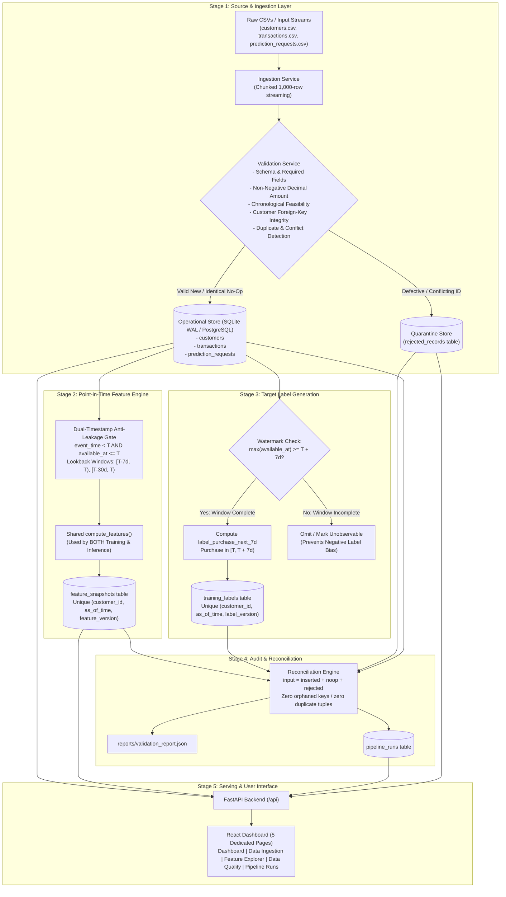
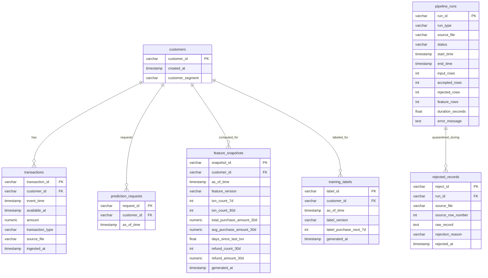

# TimeSafe Feature Pipeline: Complete Project Flow & System Architecture Guide

> **Purpose of this Document:**  
> This file is an exhaustive, self-contained architectural reference designed to be provided to an AI (such as ChatGPT) or technical evaluators. It explains the entire end-to-end data lifecycle, engineering decisions, anti-leakage rules, database schemas, and codebase layout of the **TimeSafe** point-in-time feature store.

---

## 1. System Overview & Problem Statement

### 1.1 Business Context
TimeSafe is an enterprise-grade ML Feature Store and Data Engineering pipeline built for an **E-Commerce Transactional Platform**. The business goal is to predict:
> *"Will customer $C$ make at least one purchase within the next 7 days after prediction cutoff timestamp $T$?"*

### 1.2 The Core Data Engineering Problem
In naive machine learning pipelines, two critical data engineering flaws routinely destroy model performance in production:
1. **Target / Feature Leakage (Temporal Contamination)**: Features computed for a historical prediction timestamp $T$ accidentally ingest transactions that occurred after $T$ ($event\_time \ge T$), or transactions that occurred before $T$ but were physically unavailable in the warehouse until after $T$ ($available\_at > T$).
2. **Train / Serve Skew**: Feature engineering formulas used for offline training datasets (e.g. complex SQL batch queries) differ from online inference calculations (e.g. Python microservice logic), causing subtle numerical or null-handling discrepancies.

### 1.3 The TimeSafe Solution
TimeSafe enforces:
- **Strict Dual-Timestamp Point-in-Time Filtering**: Every event is evaluated against both its real-world occurrence (`event_time`) and warehouse visibility (`available_at`).
- **Single Shared Feature Engine**: A single, unified `compute_features()` Python function serves both batch training set generation and live inference preview.
- **Watermark-Gated Label Generation**: Labels are computed by an independent service with a strict data watermark check ($\max(available\_at) \ge T + 7\text{ days}$) to prevent false negative labels on incomplete future windows.
- **Rerun Safety & Idempotency**: Identical re-runs produce 100% safe no-ops; conflicting IDs route to an auditable quarantine table.
- **Mathematical Reconciliation**: Every row is accounted for via $\text{input\_rows} = (\text{inserted\_rows} + \text{noop\_rows}) + \text{rejected\_rows}$.

---

## 2. High-Level Architecture Diagram



---

## 3. The 5 Detailed Pipeline Stages

### Stage 1: Source & Ingestion Layer
- **Input Manifests**:
  1. `customers.csv`: `customer_id`, `created_at`, `customer_segment`
  2. `transactions.csv`: `transaction_id`, `customer_id`, `event_time`, `available_at`, `amount`, `transaction_type`, `source_file`
  3. `prediction_requests.csv`: `request_id`, `customer_id`, `as_of_time`
- **Ingestion Execution** (`backend/services/ingestion_service.py`):
  - Streams records in 1,000-row chunks.
  - Generates a new operational execution record in `pipeline_runs` with status `running`.
- **Validation Engine** (`backend/services/validation_service.py`):
  - **Schema Validation**: Ensures all required fields are present and non-null.
  - **Decimal Conversion**: Amount parsed with `Decimal(str(val))`; validates `amount >= 0`.
  - **Transaction Types**: Strictly restricted to `'purchase'` or `'refund'`.
  - **Chronological Feasibility**: Verifies `available_at >= event_time`.
  - **Timeline Referential Check**: Verifies `customer_id` exists AND `transaction.event_time >= customer.created_at`.
- **Deduplication & Quarantine Policy**:
  - **Identical Record Re-run**: If an ingested record matches an existing transaction on `(customer_id, event_time, available_at, amount, transaction_type)`, it is treated as a safe **NO-OP**. `noop_rows` is incremented, and no duplicate database write occurs.
  - **Conflicting Primary Key**: If an incoming record has an existing `transaction_id` but *different* attributes, it is routed to `rejected_records` with reason `CONFLICTING_PRIMARY_KEY`.
  - **In-File Duplicates**: First occurrence is accepted; subsequent occurrences in the same batch are quarantined with `DUPLICATE_TRANSACTION_ID_IN_FILE`.

---

### Stage 2: Point-in-Time Feature Engineering Layer
- **The Core Anti-Leakage Equation**:  
  For prediction cutoff $T$, an event $tx$ may contribute to features if and only if:
  $$\text{Eligible}(tx, T) \iff tx.event\_time < T \quad \mathbf{AND} \quad tx.available\_at \le T$$

- **Lookback Window Boundaries**:
  - **7-Day Window**: $[T - 7\text{ days}, T)$. An event occurring exactly at $T - 7\text{ days}$ is **included**. An event occurring at $T$ is **excluded**.
  - **30-Day Window**: $[T - 30\text{ days}, T)$. An event occurring exactly at $T - 30\text{ days}$ is **included**.
  - **Late-Arriving Events**: A transaction with $event\_time < T$ but $available\_at > T$ was not yet visible in the system at cutoff $T$; it is **strictly excluded**.
  - **Customer Pre-existence**: If $T < customer.created\_at$, feature generation throws a validation error (the customer did not exist yet at cutoff).

- **Engineered Feature Definitions**:
  1. `txn_count_7d`: Total eligible transactions (purchases + refunds) in $[T - 7\text{d}, T)$.
  2. `txn_count_30d`: Total eligible transactions in $[T - 30\text{d}, T)$.
  3. `total_purchase_amount_30d`: Decimal sum of eligible purchase transactions in $[T - 30\text{d}, T)$.
  4. `avg_purchase_amount_30d`: Mean amount of eligible purchase transactions in $[T - 30\text{d}, T)$ ($0.00$ if count is 0).
  5. `days_since_last_txn`: Elapsed fractional days from $T$ to the latest eligible transaction before $T$ (`NULL` / `None` if 0 transactions).
  6. `refund_count_30d`: Total eligible refunds in $[T - 30\text{d}, T)$.
  7. `refund_amount_30d`: Decimal sum of refund amounts in $[T - 30\text{d}, T)$.

- **Zero / Empty Conventions**:
  When a customer has zero transactions in the window:
  `txn_count_7d = 0`, `txn_count_30d = 0`, `total_purchase_amount_30d = 0.00`, `avg_purchase_amount_30d = 0.00`, `days_since_last_txn = NULL`, `refund_count_30d = 0`, `refund_amount_30d = 0.00`.

- **Unified Function Implementation** (`backend/services/feature_engineering.py`):
  `compute_features(transactions, customer_id, as_of_time, feature_version="v1")`  
  This identical function processes both Pandas DataFrames (offline training batch) and raw Python dicts (online inference).

- **Target Table**: `feature_snapshots` with unique constraint `(customer_id, as_of_time, feature_version)`.

---

### Stage 3: Target Label Generation Layer
- **Target Definition**: `label_purchase_next_7d`
  - Window: $[T, T + 7\text{ days})$.
  - Value: `1` if at least one qualifying purchase occurs in $[T, T + 7\text{ days})$; otherwise `0`.
- **Decoupled Architecture**: Handled by `backend/services/label_generation.py`. Features never inspect or import label data.
- **The Watermark Completeness Gate**:
  - The system checks the global data watermark: $\text{watermark} = \max(available\_at)$.
  - **If $\text{watermark} < T + 7\text{ days}$**: The future window has not completed. Marking this `0` would create **negative label leakage** (treating unobserved periods as non-purchases). Therefore, the record is flagged `is_observable = False` and omitted from the training labels table.
  - **If $\text{watermark} \ge T + 7\text{ days}$**: Window is complete and ground truth is recorded in `training_labels`.

---

### Stage 4: Audit & Reconciliation Layer
- **Row Accounting Conservation Law**:
  $$\text{input\_rows} = \text{accepted\_rows} + \text{rejected\_rows} = (\text{inserted\_rows} + \text{noop\_rows}) + \text{rejected\_rows}$$
- **Integrity Audits** (`backend/services/reconciliation.py`):
  1. **Referential Integrity**: Zero orphaned transactions ($tx.customer\_id \notin customers$) and zero orphaned feature snapshots.
  2. **Uniqueness**: Zero duplicate `(customer_id, as_of_time, version)` tuples.
  3. **Run Audit**: Verifies every batch run's quarantine row count strictly equals the count of records in `rejected_records`.
- **Validation Report**: Emits structured JSON to `reports/validation_report.json` with status `PASSED` or `FAILED`.

---

### Stage 5: Serving & User Interface Layer
- **FastAPI Endpoints** (`backend/api/`):
  - `GET /api/health`: Database connectivity and health status.
  - `POST /api/generate-data`: Seed 42 deterministic dataset generation.
  - `POST /api/ingest`: Chunked CSV ingestion with multipart upload support.
  - `POST /api/pipeline/run`: Synchronous trigger of end-to-end pipeline.
  - `GET /api/pipeline/runs`: History of all pipeline executions and durations.
  - `GET /api/pipeline/runs/{run_id}`: Granular run telemetry.
  - `GET /api/features`: Query historical snapshots with customer/version filters.
  - `POST /api/features/preview`: Live, on-demand feature preview for arbitrary cutoff $T$ with zero database writes.
  - `GET /api/export/features`: Stream feature snapshots as CSV download.
  - `GET /api/rejects`: Query quarantined records and rejection reasons.
  - `GET /api/metrics`: Aggregate KPIs, row counts, and reconciliation status.
  - `GET /api/reports/reconciliation`: JSON reconciliation audit report.

- **React Dashboard Pages** (`frontend/src/pages/`):
  1. **Dashboard (`Dashboard.jsx`)**: Real-time KPI cards, accepted vs rejected bar chart, rejection reasons breakdown, duration tracking, live reconciliation badge.
  2. **Data Ingestion (`DataIngestion.jsx`)**: Controls for synthetic generator (seed, rows count, invalid toggle), CSV upload, run trigger button, source manifest status.
  3. **Feature Explorer (`FeatureExplorer.jsx`)**: Feature table, search filters, CSV export, and an interactive **Live Feature Preview sandbox** to test cutoffs in real time.
  4. **Data Quality (`DataQuality.jsx`)**: Traceable quarantine store with raw JSON payload inspection, line numbers, and error categorization.
  5. **Pipeline Runs (`PipelineRuns.jsx`)**: Operational audit trail of all batch runs with execution durations and row balance equations.

---

## 4. Train vs Inference Parity Walkthrough

```mermaid
sequenceDiagram
    autonumber
    actor DS as Data Scientist / Batch Pipeline
    actor API as Real-Time Inference Client
    participant Engine as compute_features() [Single Shared Function]
    participant DB as SQLite / PostgreSQL Database

    Note over DS,API: Training/Inference Parity Guarantee
    
    rect rgb(20, 30, 50)
    Note over DS,Engine: Offline Training Path
    DS->>DB: Query customer txs where event_time < T AND available_at <= T
    DB-->>DS: Return transactions DataFrame
    DS->>Engine: compute_features(df, customer_id, T)
    Engine-->>DS: Returns Feature Snapshot Dict
    DS->>DB: Query Label where max(available_at) >= T + 7d
    DB-->>DS: Join Feature Snapshot + Training Label
    end

    rect rgb(30, 45, 30)
    Note over API,Engine: Online Inference Path (Zero Skew)
    API->>Engine: compute_features(recent_txs, customer_id, T_current)
    Engine-->>API: Returns Identical Feature Snapshot Dict (No future labels)
    end
```



By ensuring that the exact same mathematical logic, null conventions, window boundaries, and rounding rules are used in both pathways, **train/serve skew is completely eliminated**.

---

## 5. Complete Database Schema



### Table Definitions & Key Constraints
1. **`customers`**: Primary key `customer_id`. Indexed.
2. **`transactions`**: Primary key `transaction_id`. Foreign key `customer_id` referencing `customers.customer_id`. Checks: `amount >= 0`, `transaction_type IN ('purchase', 'refund')`. Composite index: `(customer_id, event_time, available_at)`.
3. **`prediction_requests`**: Primary key `request_id`. Foreign key `customer_id`. Indexed lookup on `(customer_id, as_of_time)`.
4. **`feature_snapshots`**: Primary key `snapshot_id`. Unique constraint: `(customer_id, as_of_time, feature_version)` ensures idempotent reruns.
5. **`training_labels`**: Primary key `label_id`. Unique constraint: `(customer_id, as_of_time, label_version)`. Check: `label_purchase_next_7d IN (0, 1)`.
6. **`pipeline_runs`**: Primary key `run_id`. Tracks execution start/end, row counts, duration, and error trace.
7. **`rejected_records`**: Primary key `reject_id`. Foreign key `run_id` referencing `pipeline_runs.run_id`. Stores exact line number and raw JSON payload.

---

## 6. Codebase File Map & Responsibilities

| File Path | Component | Core Responsibility |
|---|---|---|
| `backend/main.py` | FastAPI Application | Main API entrypoint, CORS configuration, `/docs` Swagger setup, and startup database schema creation. |
| `backend/app/main.py` | App Wrapper | Drop-in alias allowing `uvicorn app.main:app` or `uvicorn backend.main:app`. |
| `backend/config.py` | Settings & Paths | Environment variable loading, file paths (`data/raw`, `reports/`), and CORS origins. |
| `backend/schemas.py` | Pydantic v2 Models | Request/response DTOs for API validation, feature previews, runs, and metrics. |
| `backend/services/validation_service.py` | Data Quality Rules | Schema checks, ISO-8601 UTC timestamp parsing, decimal validation, and chronological integrity. |
| `backend/services/ingestion_service.py` | Streaming Ingest | Chunked CSV reader, conflict-aware duplicate detection (identical=noop, conflicting=quarantine). |
| `backend/services/feature_engineering.py` | Feature Engine | Single shared `compute_features()` function, point-in-time dual timestamp filtering, window lookbacks. |
| `backend/services/label_generation.py` | Ground Truth Labels | Future window $[T, T+7\text{d})$ purchase detection with data watermark completeness checks. |
| `backend/services/pipeline_runner.py` | Orchestrator | Sequential batch coordinator (customers $\rightarrow$ txs $\rightarrow$ cutoffs $\rightarrow$ features $\rightarrow$ labels $\rightarrow$ audit). |
| `backend/services/reconciliation.py` | Math Auditor | Conservation accounting: $\text{input} = \text{accepted} + \text{rejected}$; outputs `validation_report.json`. |
| `backend/api/ingestion.py` | Ingest API Routes | `POST /api/generate-data`, `POST /api/ingest`, `GET /api/rejects`. |
| `backend/api/pipeline.py` | Pipeline API Routes | `POST /api/pipeline/run`, `GET /api/pipeline/runs`, `GET /api/pipeline/runs/{id}`. |
| `backend/api/features.py` | Features API Routes | `GET /api/features`, `POST /api/features/preview`, `GET /api/export/features`. |
| `backend/api/reports.py` | Observability Routes | `GET /api/health`, `GET /api/metrics`, `GET /api/reports/reconciliation`. |
| `database/models.py` | SQLAlchemy ORM | Database table models, constraints, relationships, indexes, and `ensure_utc` timestamp normalizer. |
| `database/db.py` | Database Connection | SQLite engine configuration with WAL mode (`PRAGMA journal_mode=WAL;`) and foreign keys (`PRAGMA foreign_keys=ON;`). |
| `database/schema.sql` | DDL Reference | ANSI SQL schema definition for SQLite, PostgreSQL, and Supabase migrations. |
| `scripts/generate_data.py` | Data Generator | Seed 42 deterministic generator for small sample (100 rows) or large sample (100,000+ rows) with SHA256 fingerprints. |
| `scripts/run_pipeline.py` | CLI Runner | Command-line execution entrypoint for running the end-to-end pipeline without a web server. |
| `scripts/benchmark.py` | Profiler | High-throughput benchmark profiling 100,000+ transactions (ingestion rate, feature rate). |
| `backend/tests/` | Pytest Suite | 43 comprehensive automated tests covering anti-leakage, edge cases, parity, idempotency, and recovery. |
| `frontend/` | React Web App | Modern dark-themed dashboard (Vite + Tailwind + Recharts + Lucide + Axios). |

---

## 7. Performance Benchmark Evidence (100,000 Rows)

Executed via `scripts/benchmark.py`:
- **Dataset Size**: 99,998 transactions across 500 customers and 100 cutoffs.
- **Data Generation Time**: 4.02 seconds.
- **Ingestion & Validation Duration**: **17.42 seconds** (**5,739.7 rows/second**).
- **Accepted / Clean Rows**: 70,614 rows.
- **Quarantined / Defective Rows**: 29,384 rows.
- **Feature Generation Duration**: **0.66 seconds** (**150.7 snapshots/second**).
- **Total Active Pipeline Time**: **18.09 seconds**.
- **Reconciliation Invariant**: $99,998 == 70,614 + 0 + 29,384$ (Exact mathematical match).

---

## 8. Quick Commands Reference

```powershell
# 1. Run all 43 automated tests
cd C:\CandidateWorkspace\timesafe-feature-pipeline
python -m pytest backend/tests -v

# 2. Run the 100,000-row performance benchmark
python scripts/benchmark.py --rows 100000 --customers 500 --predictions 100

# 3. Execute the full feature pipeline via CLI
python scripts/run_pipeline.py

# 4. Start the FastAPI backend
python -m uvicorn backend.main:app --host 127.0.0.1 --port 8000 --reload
# (Swagger Docs: http://127.0.0.1:8000/docs)

# 5. Start the React frontend
cd frontend
npm run dev
# (Dashboard: http://localhost:5173)
```
